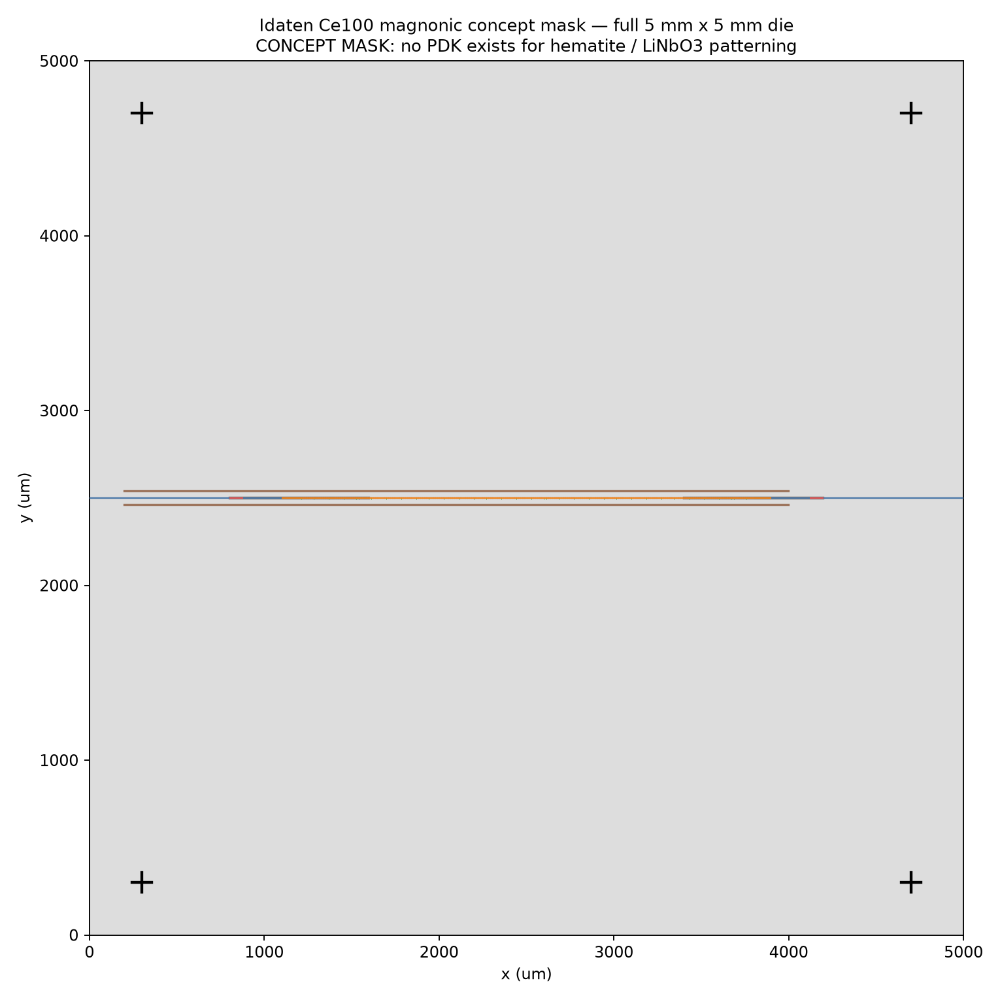
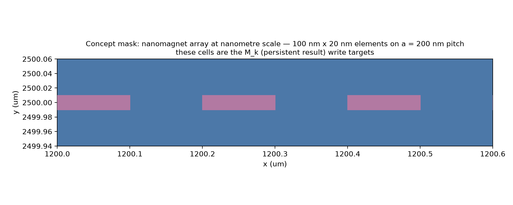

# Idaten Ce100 — Pattern-Coded Magnonic Execution

**A research architecture in which a spatially and temporally structured
transistor/switch topology acts like an execution code, magnons perform the
workload, and the result is left behind as a persistent magnetic pattern that
is read once, after the workload completes.**

This repository is a **research artifact set**, not a product and not a report
of a fabricated device. It exists so that the physics, the benchmark, the
layout, and the energy model can be inspected and criticised by people who do
not trust the author.

---

## Read this first: the evidence labels

Every number in this repository carries a tag.

| Tag | Meaning |
|---|---|
| **(L)** | **Literature** — a published, citable source (named in [`PROVENANCE.md`](PROVENANCE.md)) |
| **(S)** | **Simulated** — produced by code in this repo, with the run command and tool version recorded |
| **(E)** | **Engineering estimate** — a calculation from assumptions that are written down next to it |
| **(A)** | **Predicted** — a hypothesis. No supporting measurement exists yet |

Anything untagged is a description of intent, not a result.

**This repository does not claim** "zero resistance", "absolute zero idle
power", "free computation", "instant switching", or any global-superlative
efficiency figure. Those phrases are prohibited as established facts by the
architecture paper this work follows.

---

## Start here

| If you are… | Read this | The one question it answers |
|---|---|---|
| a **spintronics professor** | [`docs/PRIOR_ART.md`](docs/PRIOR_ART.md) → [`docs/KILL_CRITERIA.md`](docs/KILL_CRITERIA.md) | *What is genuinely new, and what would disprove it?* |
| a **foundry engineer** (IMEC-class) | [`docs/CREDIBILITY_PLAN.md`](docs/CREDIBILITY_PLAN.md) §4 | *Can you make this on 300 mm, in my process, above my logic?* |
| a **deep-tech accelerator** (Silicon Catalyst-class) | [`docs/ONE_PAGER.md`](docs/ONE_PAGER.md) → [`docs/KILL_CRITERIA.md`](docs/KILL_CRITERIA.md) | *What do you measure, by when, and what kills the project?* |
| **anyone** | [`PROVENANCE.md`](PROVENANCE.md) | *Where does every number come from?* |

### The one metric everything depends on

```
W = cells switched per wave event ÷ energy of that wave event
```

From published numbers only (E): a 1.70 GHz wave on a 40.96 µm bus transits in
**3.26 ns**; the drive-power term is **41 fJ per event**; the bus holds **205**
cells at a = 200 nm → **0.20 fJ per written cell**, against an assumed
5–20 pJ/bit for a foundry MRAM write. **That four-to-five-orders-of-magnitude
gap is a naive bound, not a result** — it assumes the whole 205-cell event is
written correctly and ignores transducer, driver and circuit overhead. It is
an assumption until measured. The valuable quantity is not that ratio but `W`:
cells switched per wave event. This is the project's headline metric, measured
with error bars in Phase 0, and it is the first thing we report, win or lose.

### The result medium is a foundry MRAM array, not a bespoke nanomagnet array

This is the single highest-leverage decision in the project, and it is why a
foundry can act on it:

* The switching element in the published precedent is a **100 nm × 20 nm
  Ni₈₁Fe₁₉** rectangle (L) — that is *already* an MRAM free-layer geometry.
* Foundry **SOT-MRAM is demonstrated manufacturable on 300 mm Si with
  CMOS-compatible processes**, with switching down to **300 ps** (L, IMEC), and
  **GF 22FDX eMRAM has been in production since 2018** (L).
* Therefore reset and readout come from a **qualified process**, and the
  piezomagnetic strain-reset hypothesis is demoted from load-bearing to
  optional optimisation.

The ask to a foundry becomes concrete and small: *we do not need a new memory
process; we need to write your memory array with a wave instead of a current.*

### The lead product is an edge magnonic spectral classifier, not a general processor

An always-on RF/spectrum classifier (wake-word detection, spectrum sensing,
anomaly detection) needs only the bus and a small read array — **one small die,
one MPW shuttle, a buyer today**. It shares the same cell and the same bus IP
with the general execution processor, which remains the research thesis and
the scale-up. Claiming the general processor first is the most common way
deep-tech pitches die.

Full analysis: [`docs/CREDIBILITY_PLAN.md`](docs/CREDIBILITY_PLAN.md).

---

## Status of the four artifacts

| # | Artifact | Status | Where |
|---|---|---|---|
| ① | **Physics proof** — micromagnetic wave propagation, interference, threshold writing, reset | Stage A tooling/analysis + Stage B deck (executed: spatial pattern only, r² fail); Stage A reproduction on adequate GPU **pending**; Stage C portfolio pending | [`notebooks/01_wave_imprinting.ipynb`](notebooks/01_wave_imprinting.ipynb) · [`tools/`](tools/) |
| ② | **AI benchmark** — analogue wave-diffraction + threshold layer vs. a matched digital baseline | **shipped** | [`notebooks/02_ai_mnist_wave.ipynb`](notebooks/02_ai_mnist_wave.ipynb) |
| ③ | **Chemistry analogue** — a programmable wave medium computing a linear Green's-function / Poisson operator, checked against an independent reference solve | **shipped** | [`notebooks/03_chem_potential_match.ipynb`](notebooks/03_chem_potential_match.ipynb) |
| ④ | **Layout** — two GDS files, deliberately labelled differently (see below) | **concept mask shipped**; SKY130 open-flow layout **in progress** | [`gds/`](gds/) · [`tools/render_gds.py`](tools/render_gds.py) |
| ⑤ | **PPA ledger** — full-system energy and latency per the architecture paper's §9 ledger, with *measured* write-power anchors | **shipped** | [`notebooks/05_ppa_ledger.ipynb`](notebooks/05_ppa_ledger.ipynb) |

---

## The four state objects

The architecture is defined by keeping four things separate. This is the
single most important idea in the design and it is what the artifacts test.

| Symbol | Name | Mutable by | Read by |
|---|---|---|---|
| `P₀` | Fabricated transistor/switch topology | not at runtime | — (fixed) |
| `C_k` | Execution configuration (switch states) | input coding, per step | control logic |
| `Ψ_k` | Live wavefield | physics | wave bus |
| `M_k` | Persistent magnetic result pattern | write stage | **final readout only** |

`C_k` and `M_k` must never be conflated. A result pattern is read **once**,
after the individual workload completes — not per operation. That is the whole
point: the compute path does not pay for electrical conversion between
operations.

---

## The two GDS files are not the same kind of thing

| File | What it is | How it is labelled |
|---|---|---|
| [`gds/idaten_concept_mask/`](gds/idaten_concept_mask/) | 5 mm × 5 mm magnonic die written with `gdstk`: bus, nanomagnet array at `a` = 200 nm, CPW launch/detect, alignment marks | **Concept mask — no PDK exists for hematite or LiNbO₃ patterning.** Dimensioned and nanometre-accurate, but *not* a manufacturable mask set. |
| `gds/idaten_sky130/` | OpenROAD Flow Scripts / SKY130 digital tier from a real open-flow run | **PDK-backed open-flow layout.** The physical instantiation of `P₀` and the `C_k` configuration switches. |

They are never shown in the same figure without their labels.





*Concept mask — no PDK exists for hematite / LiNbO₃ patterning.* The nanomagnet
array is 100 nm × 20 nm elements on a = 200 nm pitch, matching the published
precedent geometry.

---

## The credibility anchor: a published experiment, reproduced

Before claiming anything new, this project reproduces an existing result.

**Baumgaertl & Grundler, *Nature Communications* 14, 1490 (2023)** —
"Reversal of nanomagnets by propagating magnons in ferrimagnetic yttrium iron
garnet enabling nonvolatile magnon memory" (L). Dataset:
[Zenodo 10.5281/zenodo.7714181](https://doi.org/10.5281/zenodo.7714181),
CC-BY-4.0.

The authors' own MuMax³ 3.10 decks and Python plotting scripts are vendored
under [`data/zenodo_baumgaertl/`](data/zenodo_baumgaertl/). They were fetched
with **HTTP range requests only** — 151 script members totalling **1.27 MB**,
rather than the 1.66 GiB container zip:

```bash
python tools/fetch_zenodo.py data/zenodo_baumgaertl
python tools/fetch_zenodo_ovf.py data/zenodo_baumgaertl
```

Their deck fixes the published geometry and materials (S, read from the
authors' file):

| Quantity | Value |
|---|---|
| Grid | 8192 × 32 × 1, cell 5 nm × 5 nm × 5 nm |
| YIG bus | 40960 nm × 100 nm |
| Switching elements | 100 nm × 20 nm, pitch `a` = 200 nm |
| YIG | `Msat` 140 kA/m, `Aex` 3.75 pJ/m, `alpha` **9×10⁻⁴** |
| Ni₈₁Fe₁₉ | `Msat` 800 kA/m, `Aex` 13 pJ/m, `alpha` 0.01 |

Targets to match (L): k₁ = 1.70 GHz, λ = 7.4 µm, k₁ = 0.85 rad/µm; grating
mode λ = 195 nm; αᵢ = 9×10⁻⁴ → ℓ = 99 µm unpatterned, ℓ_d = 23 µm in-circuit;
P_C1 = 12.6 µW; P_C2 = 58.4 µW; **power into precession 36 nW (k₁) / 3.4 nW
(grating)**; H_C1 16.8→2.7 mT; H_C2 33.4→12.9 mT; MAMR dips at 9.25 / 10.75 /
11.75 GHz.

The authors' measured phase-diagram arrays are included as **independent ground
truth** for the switching-threshold comparison.

---

## An honest negative result we are not hiding

A prior internal series of fourteen local mumax³ decks (YIG, Bi-YIG, Co₂₅Fe₇₅,
GdFeCoP, NiFe at 2/3/5/10 GHz) was archived to compact form and re-analysed;
eleven produced recoverable snapshots and the remaining three produced no valid
OVF output. **The decay length is not recoverable from it with any
well-conditioned fit**: log-linear fits of the time-averaged envelope over
x ∈ [10, 45] µm return r² = **0.001–0.004** for every material and every
frequency, and the spatial pattern is nearly frequency-independent.

A previously circulated internal figure of "ℓ = 70 µm @2 GHz, 55 µm @3 GHz,
~148 µm @5 GHz" for that series **is therefore not supported by a
well-conditioned fit and is not carried forward as a result here.** It is
recorded in [`PROVENANCE.md`](PROVENANCE.md) as a prior internal estimate that
failed re-derivation, and the quantity is re-measured from scratch with an
explicit, stated fit method and reported with its r².

Two methodological findings are reproducible and are documented:

1. mumax³ rounds a requested `run(2e-12)` up to its own internal step. On a
   50 nm cell with `Aex` = 5 pJ/m and `Msat` = 140 kA/m the realised step is
   ≈ 23 ps, so those decks advance ≈ 581 ps per snapshot, not the 50 ps the
   script implies. Any temporal demodulation at 2–3 GHz on that geometry is
   under-sampled.
2. mumax³ OVF output is ordered **y-fastest**, then x, then z, with
   `valuedim` consecutive components per point. [`tools/ovf_extract.py`](tools/ovf_extract.py)
   implements this and is unit-checked against the CPW antenna mask geometry
   (the flared launch described below).

### Stage B status — run, but the decay length is not reportable

The Idaten extension deck `tools/decks/idaten_stageB.mx3` was executed on the
MX130 (grid 2000 × 160 × 1 at 50 nm, six `P₀` phase bands, 64 coarse-grained
NiFe result elements). It produced **40 snapshots** of `m.Comp(1)`.

| Quantity measured (S) | Result |
|---|---|
| Time-averaged bus envelope log-linear fit, x = 10–45 µm | **r² = 0.0024** (ell = 114 µm) |
| Local pattern contrast across the 64 result elements | **0.955** |
| Elements above half the maximum amplitude | **9** |
| Gate K4 (r² ≥ 0.8) | **fail** |

The pattern at the result array is non-uniform (a sparse interference-like set
of peaks), which is evidence that a fabricated landscape can imprint a
computable spatial pattern — **not** evidence of switching, reversal, or a
write-error rate. No threshold claim is made from this deck. The full local
figures are `data/lab/stageB_summary.json` and
`figures/01_stageB_pattern.png`.

### A correction we are publishing rather than quietly fixing

An earlier version of this repository described the lab CPW antenna as *"a
stripe at the y = 0 edge, x = 2–6 µm"*. **That was wrong**, and it was wrong
because the first structural probe reduced a **3-D** mask raster with
`mask.any(axis=...)`, which collapses the wrong axes and transposes the
geometry. The mask was re-rendered directly from its 2-D raster:

| Property | Value (S) |
|---|---|
| Filled cells | **662** |
| Non-empty rows | 80 (y indices 40–119) |
| Bounding box | **x ∈ [0.050, 0.500] µm, y ∈ [2.050, 6.000] µm** |
| Spine | 1-cell (50 nm) wide vertical strip at **x = 0.050 µm** over the occupied height (y = 2.05–6.00 µm) |
| Flare | right-hand edge grows from x = 0.100 µm at y = 2.05 µm to x = 0.500 µm around y ≈ 3.55–4.85 µm, then tapers back to x = 0.100 µm at y = 6.00 µm — a **diamond/lens-shaped launch** |

So the antenna is a **compact flared coplanar-waveguide launch hugging the
x = 0.05 µm edge**, and the wave propagates **along +x** from x ≳ 0.5 µm. The
corrected renderer is [`tools/probe_antenna.py`](tools/probe_antenna.py).

The error is recorded in [`PROVENANCE.md`](PROVENANCE.md) §2.3 rather than
deleted, because it survived in two documents on the strength of a plausible
claim that nobody re-checked against the file. Every geometry claim here is now
verified by re-rendering the artifact.

---

## The chemistry artifact, stated precisely

Notebook 03 claims **analogue-operator equivalence** and nothing more.

A programmable 2-D wave medium computes a **linear Green's-function / Poisson
operator** by interference. The result is compared against an **independent
reference solve** with a stated error bound. **PySCF** is used only as an
independent quantum-chemistry cross-check of the same molecular geometry (SCF
energy); it is not an input to the analogue and is not compared to the
analogue density.

This repository does **not** claim that spin waves emulate Schrödinger or
Kohn–Sham operators, and does **not** claim to "solve DFT". A magnon obeys a
dispersive wave equation with a magnonic dispersion relation; an electron
wavefunction obeys Schrödinger with a Coulomb potential. They are not the same
operator, and the difference is not something a slide can absorb.

---

## Repository map

```
README.md                  this file
PROVENANCE.md              evidence ledger: every number, its tag, and its source
notebooks/
  01_wave_imprinting.ipynb    physics: published precedent -> Idaten extension -> materials
  02_ai_mnist_wave.ipynb      analogue wave layer vs matched digital baseline
  03_chem_potential_match.ipynb  Green's-function / Poisson analogue + independent ground truth
  04_generate_gds_mask.ipynb  concept mask generation + KLayout inspection
  05_ppa_ledger.ipynb         full-system energy and latency ledger
tools/
  ovf_extract.py           mumax3 OVF reader (text + binary, y-fastest order)
  probe_antenna.py         CORRECTED structural probe: renders the CPW mask raster
  archive_lab2.py          compact archival of mumax3 snapshot series (resumable)
  analyze_stageB.py        Stage B MX130 output -> small committed metrics (S)
  analyze_ovf.py           wave metrics: envelope, wavefront, decay length
  build_lab_summary.py     filters the raw archiver output into committed evidence
  generate_concept_mask.py the 5 mm x 5 mm magnonic concept mask
  render_gds.py            KLayout layer census + figures
  fetch_zenodo.py          range-request fetch of the published precedent scripts
  fetch_zenodo_ovf.py      range-request fetch of the drive files and arrays
  fetch_mnist.py           MNIST IDX fetch/cache for notebook 02 (falls back to
                           sklearn digits if absent)
  decks/idaten_stageB.mx3  Stage B pattern-coded deck (P0 phase grating + result array)
  build_notebooks.py       notebook source -> .ipynb builder
  run_notebooks.py         executes every notebook in place, reports the failing cell
  nb0*.py                  the notebook sources (editable; the .ipynb are built from them)
data/
  zenodo_baumgaertl/      vendored, CC-BY-4.0 (see _manifest.json for provenance)
  mnist/                   NOT committed (~12 MB, gitignored) - MNIST, Yann LeCun
                           et al., CC BY-SA 3.0, fetched by tools/fetch_mnist.py;
                           benchmark results derived from it ARE committed
  lab/                    archived local series metrics, antenna geometry summary,
                          and Stage B (deck output not committed); see data/lab/README.md
gds/
  idaten_concept_mask/     CONCEPT MASK - no PDK for hematite/LiNbO3 patterning
  idaten_sky130/           PDK-backed open-flow layout (in progress)
figures/                   rendered evidence
docs/
  CREDIBILITY_PLAN.md      the three audience gates, the write-amplification metric,
                           the MRAM re-specification, the roadmap
  PRIOR_ART.md             differentiation table, closest prior art, what is NOT novel, IP
  KILL_CRITERIA.md         K0-K11 binary gates with thresholds and fallbacks
  ONE_PAGER.md             the accelerator-facing one-page summary
  device_ledger.md         per-element ledger required by architecture paper section 10
openflow/
  README.md                SKY130/ORFS status: PDK-backed open-flow layout, not present yet
```

---

## Reproducing

```bash
python -m pip install -r requirements.txt

# 1 - the concept mask + its inspection (Windows or Linux, ~30 s)
python tools/generate_concept_mask.py --out gds/idaten_concept_mask
python tools/render_gds.py --gds gds/idaten_concept_mask/idaten_concept_mask.gds --out figures

# 2 - the published precedent scripts (network, ~1.3 MB via range requests)
python tools/fetch_zenodo.py data/zenodo_baumgaertl

# 3 - the AI benchmark dataset (MNIST subset, ~12 MB)
python tools/fetch_mnist.py

# 4 - the notebooks
jupyter lab notebooks/
```

The micromagnetic stages need **mumax³ 3.12** (or **mumax⁺ 1.2.2** for the
antiferromagnetic Néel-vector stage) on a CUDA GPU, and are driven through
shell scripts so that quoting is never mangled by the Windows shell.

---

## Licence and provenance

- This repository's own code: see [`LICENSE`](LICENSE).
- `data/zenodo_baumgaertl/` is vendored from Zenodo record
  `10.5281/zenodo.7714181` under **CC-BY-4.0**, © the original authors. Every
  file's origin is recorded in `_manifest.json` / `_ovf_manifest.json`.
- The architecture document that defines the four state objects, the R0–R6
  ladder, Gate 0–8, the §9 energy ledger and the §10 guidance is
  *Idaten Ce100: Pattern-Coded Magnonic Execution, Persistent Magnetic Results,
  and Dynamic Rails*, rev. 16 Nov 2026.
